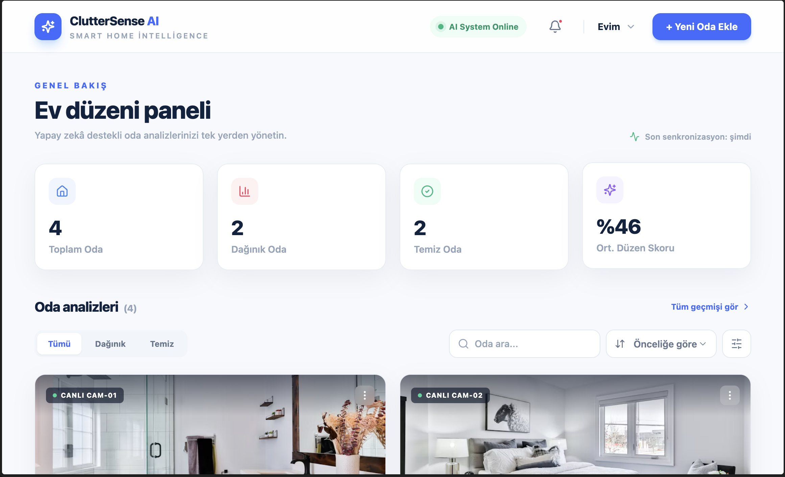
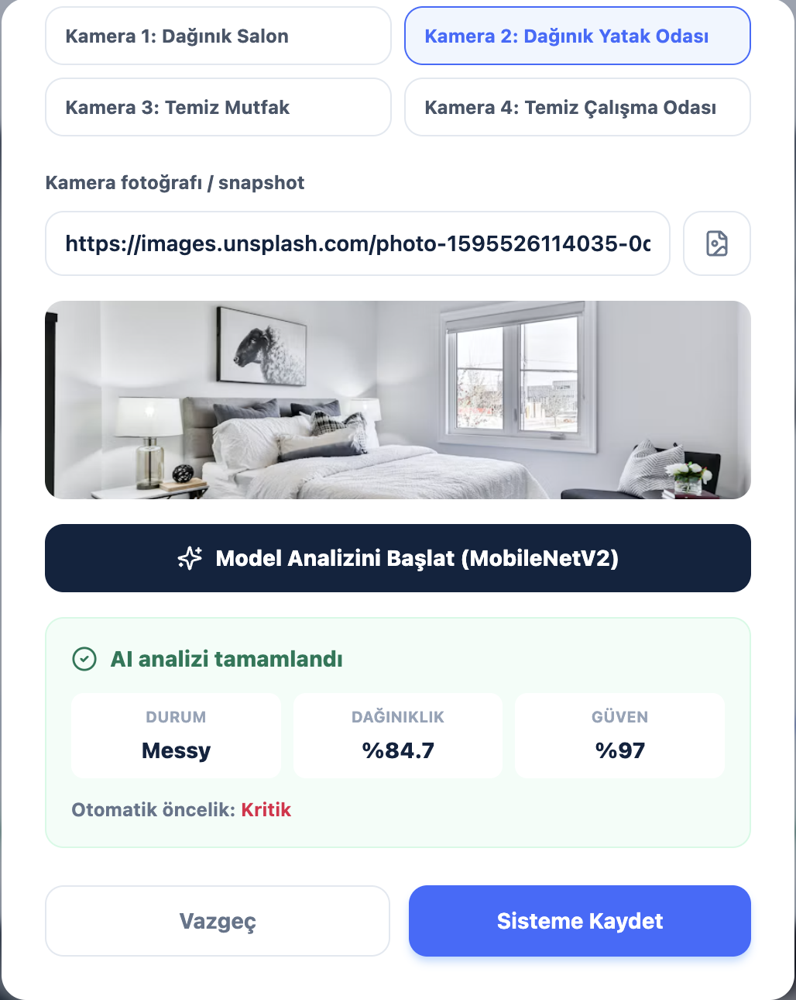

# ClutterSense AI

ClutterSense AI, ev kameralarından gelen görüntülerle odaların düzenini takip eden bir kontrol panelidir. Her oda için dağınıklık durumu (Clean / Messy), dağınıklık skoru, model güveni, temizlik önceliği ve öneri listesi gösterilir.

Oda görüntülerini sınıflandıran model, ayrı bir derin öğrenme projesinde **MobileNetV2** ile eğitildi. Bu arayüzde model çalıştırılmıyor; analiz adımı simüle ediliyor:

- Hazır kamera karelerinden biri seçilirse, o kareye ait beklenen sonuç üretilir (dağınık odalar için skor 80–95, temiz odalar için 5–25).
- Kullanıcı kendi URL'ini veya dosyasını yüklerse skor 0–100 arasında rastgele belirlenir, 50 ve üzeri "Messy" sayılır ve sonuç kutusunda "Demo analiz (simülasyon)" etiketi gösterilir.
- Model güveni skordan türetilir: `max(skor, 100 - skor)`.

**Canlı demo:** https://clutterai.netlify.app/

## Kullanılan teknolojiler

- React 18
- Vite
- Tailwind CSS
- lucide-react (ikonlar)
- LocalStorage (veri kalıcılığı)
- Netlify (yayın)

## CRUD işlemleri

| İşlem | Arayüzde nerede |
| --- | --- |
| **Ekle (Create)** | Üst menüdeki **"+ Yeni Oda Ekle"** butonu. Açılan pencerede oda bilgileri girilir, kamera karesi seçilir veya yüklenir, analiz başlatılır ve kaydedilir. |
| **Listele (Read)** | Ana sayfadaki oda kartları. Kartlar durum filtresiyle (Tümü / Dağınık / Temiz), aramayla (oda adı, kamera adı ve bölge) ve sıralamayla (öncelik, skor, ad) daraltılabilir. |
| **Güncelle (Update)** | Karttaki **kalem ikonu** odayı düzenleme penceresini açar. **"Toparlandı"** butonu odayı temiz olarak işaretler; skor, öncelik, kontrol zamanı ve öneri listesi güncellenir. |
| **Sil (Delete)** | Karttaki **çöp kutusu ikonu**. Onay alındıktan sonra oda silinir. |

Veriler tarayıcının LocalStorage'ında tutulur. Örnek odalar yalnızca ilk açılışta yüklenir; tüm odalar silinirse liste boş kalır. Yüklenen görseller en fazla 800 px genişliğe küçültülüp base64 (JPEG) olarak kaydedilir, bu yüzden sayfa yenilendiğinde kaybolmaz.

## Proje yapısı

```text
ClutterSense-AI/
├── docs/                     # README ekran görüntüleri
├── src/
│   ├── components/
│   │   ├── AddRoomModal.jsx  # Oda ekleme / düzenleme penceresi ve analiz simülasyonu
│   │   ├── FilterBar.jsx     # Durum filtresi, arama ve sıralama
│   │   ├── Navbar.jsx        # Üst menü ve "+ Yeni Oda Ekle" butonu
│   │   ├── RoomCard.jsx      # Oda kartı (düzenle, toparlandı, sil)
│   │   └── StatsHeader.jsx   # Özet istatistik kartları
│   ├── interfaces/
│   │   └── roomModel.js      # Oda modeli, örnek veriler, öncelik hesabı
│   ├── pages/
│   │   └── Dashboard.jsx     # Ana sayfa ve CRUD işlemleri
│   ├── utils/
│   │   └── storage.js        # LocalStorage okuma / yazma
│   ├── App.jsx
│   ├── main.jsx
│   └── index.css
├── index.html
├── netlify.toml
├── package.json
├── tailwind.config.js
└── vite.config.js
```

## Kurulum

```bash
npm install
npm run dev
```

Production build:

```bash
npm run build
npm run preview
```

## Ekran Görüntüleri

### Kontrol paneli



### Yeni oda ekleme


